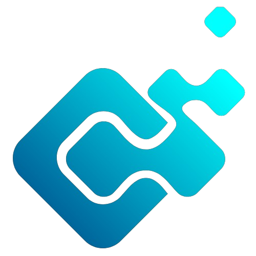

<div align="center">
  
  <h1>🪙 @m3rcena/eco</h1>
  <p><strong>The ultimate enterprise-grade Discord.js v14 economy, progression, stock market, and casino engine.</strong></p>
  <p>
    <a href="https://www.npmjs.com/package/@m3rcena/eco"></a>
    
    
    
    <a href="https://github.com/M3rcena/m3rcena-eco/blob/main/LICENSE"></a>
    <a href="https://github.com/M3rcena/m3rcena-eco/wiki"></a>
  </p>
</div>

> 📚 **Complete Documentation Wiki**: For detailed guides, bank vaults, credit score formulas, tax rates, and API reference, visit the **[@m3rcena/eco Official Wiki](https://github.com/M3rcena/m3rcena-eco/wiki)**:
> - **[Real Economy: Bank Vaults, Loans, Bills & Taxes](https://github.com/M3rcena/m3rcena-eco/wiki/Real-Economy)**
> - **[Careers, Jobs, Shop & Businesses](https://github.com/M3rcena/m3rcena-eco/wiki/Careers-and-Shop)**
> - **[Casino & Gambling Suite](https://github.com/M3rcena/m3rcena-eco/wiki/Casino-Suite)**
> - **[Stocks, Heists, Pets & Loot Crates](https://github.com/M3rcena/m3rcena-eco/wiki/Stocks-Heists-and-Pets)**
> - **[Dashboard Bridge Integration](https://github.com/M3rcena/m3rcena-eco/wiki/Bridge-Integration)**

---

## 🌟 Highlights

- 💳 **Visual Canvas Debit Cards & Financial Passports**: High-resolution (850x500) debit cards generated via `@napi-rs/canvas` with tier gradients (Bronze, Silver, Gold, Platinum, Obsidian, Mythic), laser chips, contactless arcs, user avatars, and interactive profile tabs (`Overview`, `Backpack`, `Businesses`, `Stocks`, `Pets`).
- 📈 **Stock & Cryptocurrency Exchange**: Simulated market engine with real-time volatility, bull/bear trends, and 800x400 neon candlestick/sparkline charts (`RenderMarketChart`). Trade tech stocks and crypto ($AETH, $NEXU, $CORE, ₿BIT, ΞETH) with live PnL tracking.
- 🏦 **Multiplayer Syndicate Bank Heists**: Assemble a crew in Discord with specialized roles (`💻 Hacker`, `🚗 Getaway Driver`, `💣 Demolitionist`, `💪 Heavy Muscle`), choose high-security targets (`Nightshift Mart Safe` to `Federal Reserve Sub-Basement`), and launch interactive vault breaches with synchronized loot sharing or SWAT bail fines!
- 🐾 **Companion Pets & Foraging Expeditions**: Adopt cybernetic K9s, fortune cats, or obsidian dragons. Feed pets, level them up, and dispatch them on timed foraging expeditions to bring back randomized cash and XP!
- 🎁 **Quantum Mystery Loot Crates**: Unbox mystery crates (`Common`, `Rare`, `Epic`, `Legendary`, `Mythic`) with suspenseful unboxing animations and drop table distributions.
- 🛍️ **Interactive Shop & Backpack**: Filter categories (`Consumables`, `Upgrades`, `Collectibles`), inspect items, and purchase directly via Discord Components V2 select menus and buttons.
- 🎰 **Casino & Gambling Suite**: Components V2 interactive Blackjack table (Hit, Stand, Double Down), Coinflip, Roulette, Crash multiplier rockets, Dice, and Slots.
- 🏢 **Passive Business Enterprises**: Buy and upgrade companies (Lemonade Stands, Coffee Chains, Off-World Mining) with employee hiring and offline profit accumulation.
- 🏆 **Interactive Leaderboards**: Paginated top rankings with metric selection (`Net Worth`, `Wallet`, `Bank`, `Level`, `Streaks`).
- 💾 **Native SQLite & Enterprise Prisma Storage**: Built-in zero-dependency local SQLite (`node:sqlite` WAL mode via `SqliteEcoStorage`) and auto-migrating Prisma ORM adapter (`PrismaEcoStorage`).
- 🦀 **Rust-Style Submodule Resolver**: Install and host via Git submodules locally with zero npm dependencies or transparently fall back to npm (`@m3rcena/eco/resolver`, `@m3rcena/eco/register`, `@m3rcena/eco/host`).
- 🌐 **Dashboard Bridge**: Native integration with `@m3rcena/bridge` for real-time WebSocket syncing and presence-filtered audio cues (`coin_drop`, `win`, `purchase`, `rob_siren`).
- 🤖 **Discord.js v14.28.1 Ready**: Fully compatible with the latest Discord.js updates and `clientReady` lifecycle.
- ⚡ **Next-Gen Performance**: Dual ESM/CJS, TypeScript 7.0 definitions, zero bloat, and sub-millisecond execution.

---

## 📦 Installation

### Option A: Standard NPM Installation

```bash
# npm
npm install @m3rcena/eco @m3rcena/bridge @napi-rs/canvas discord.js

# pnpm
pnpm add @m3rcena/eco @m3rcena/bridge @napi-rs/canvas discord.js

# yarn
yarn add @m3rcena/eco @m3rcena/bridge @napi-rs/canvas discord.js
```

> **Note**: Requires Node.js **22.0.0+** (LTS 22, 24, 26). Node 20 is EOL and unsupported.

### Option B: Local Git Submodule (Rust-Style Resolver)

You can vendor and host `@m3rcena/eco` locally via Git submodules without needing to publish or pull from npm:

```bash
git submodule add https://github.com/M3rcena/m3rcena-eco.git submodules/m3rcena-eco
```

Add auto-registration at the top of your app entrypoint:
```typescript
import "@m3rcena/eco/register";
```

Or run standalone hosting:
```bash
npx tsx @m3rcena/eco/host --port 5124
```

---

## 💾 Database Handlers & Persistence

`@m3rcena/eco` supports native SQLite WAL mode, Prisma ORM, and JSON file storage:

```typescript
import {
  EcoManager,
  SqliteEcoStorage,   // Zero-dependency SQLite (WAL mode)
  PrismaEcoStorage,   // PostgreSQL / MySQL / SQLite via Prisma ORM
  JsonEcoStorage,     // Lightweight JSON file storage
} from "@m3rcena/eco";

// Zero-dependency SQLite with WAL journal mode:
const eco = new EcoManager({
  storage: new SqliteEcoStorage("./data/economy.sqlite"),
});
```

---

## 🚀 Quick Example

```typescript
import { Client, GatewayIntentBits } from "discord.js";
import {
  EcoManager,
  JsonEcoStorage,
  EcoProfileUI,
  EcoStockMarketUI,
  EcoHeistUI,
  EcoBlackjackUI,
  EcoShopUI,
} from "@m3rcena/eco";

const eco = new EcoManager({
  currencySymbol: "🪙",
  currencyName: "Coins",
  storage: new JsonEcoStorage("./data/economy.json"),
});

const client = new Client({
  intents: [GatewayIntentBits.Guilds, GatewayIntentBits.GuildMessages, GatewayIntentBits.MessageContent],
});

client.on("interactionCreate", async (interaction) => {
  if (!interaction.isChatInputCommand()) return;

  // 1. Visual Financial Passport with Canvas Debit Card
  if (interaction.commandName === "profile") {
    return new EcoProfileUI(eco, { context: interaction }).start();
  }

  // 2. Interactive Live Stock & Crypto Exchange Terminal
  if (interaction.commandName === "stocks") {
    return new EcoStockMarketUI(eco, { context: interaction }).start();
  }

  // 3. Multiplayer Syndicate Crew Bank Heist
  if (interaction.commandName === "heist") {
    return new EcoHeistUI(eco, { context: interaction }).start();
  }

  // 4. Interactive Components V2 Blackjack Table
  if (interaction.commandName === "blackjack") {
    const bet = interaction.options.getInteger("amount", true);
    return new EcoBlackjackUI(eco, { context: interaction, betAmount: bet }).start();
  }

  // 5. Interactive Marketplace
  if (interaction.commandName === "shop") {
    return new EcoShopUI(eco, { context: interaction }).start();
  }
});

client.login(process.env.DISCORD_TOKEN);
```

---

## 🧩 Plug-and-Play Interactive Discord UI Modules

Like `@m3rcena/weky`, `@m3rcena/eco` provides ready-to-run interactive Discord runners built with modern **Components V2** containers, select menus, and action rows. Developers can launch complete interactive interfaces in a single line of code:

| UI Runner | Description | Features |
|---|---|---|
| `EcoProfileUI` | Financial Passport & Debit Card | High-res Canvas debit card, tabbed inspection (`Overview`, `Backpack`, `Businesses`, `Stocks`, `Pets`) |
| `EcoStockMarketUI` | Stock & Crypto Exchange Terminal | Neon candlestick/sparkline charts, ticker selection, Buy 1x/10x, Sell All, live price refresh |
| `EcoHeistUI` | Multiplayer Syndicate Bank Heist | Target vault selection, role recruitment (`Hacker`, `Driver`, `Demo`, `Muscle`), breach simulation |
| `EcoBlackjackUI` | VIP Blackjack Table | Components V2 dealer table, Hit, Stand, Double Down, card totals |
| `EcoCrateUI` | Mystery Loot Crate Unboxing | Crate tier picker, unboxing suspense sequence, item and coin reveal |
| `EcoShopUI` | Marketplace Terminal | Category filter select menu, item cards, buy buttons, quantity picker |
| `EcoLeaderboardUI` | Server Leaderboards | Metric select menu (`Net Worth`, `Wallet`, `Bank`, `Level`, `Streaks`), pagination |

---

## 📖 Complete Documentation

For detailed guides, API reference, custom storage adapters, and bridge setup, see [DOCUMENTATION.md](./DOCUMENTATION.md).

---

## 🛡️ License

Apache-2.0 © [M3rcena Development](https://github.com/M3rcena)
